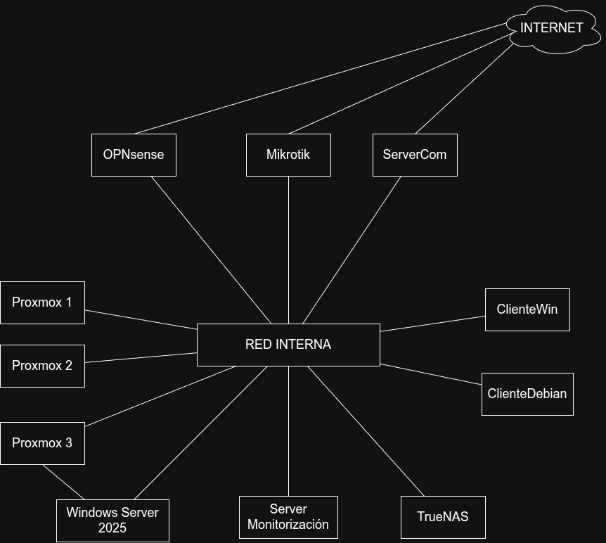

# Esquema de Red

Se va a plasmar el esquema de la red y sus elementos.

## 

Los equipos OPNsense, MikroTik y ServerCom estan conectaods con dos interfaz para tener conexión a internet a la red interna

RED INTERNA es el punto que conecta los equipos y servicios

El Windows Server 2025 está conectado a al proxmox como que está virtualizado
